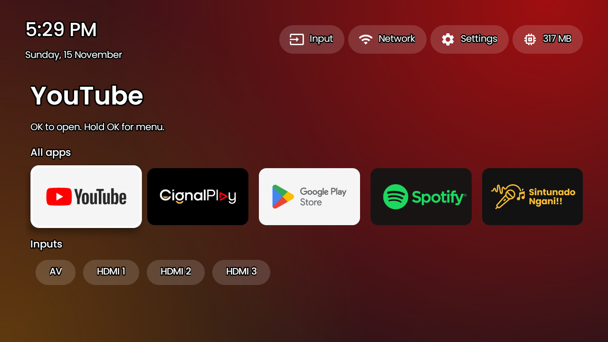

# Zero Home

A light Home screen (launcher) for Android TVs, including TVs whose firmware forces its own launcher.



- **Colour glow:** the background takes the colour of the app you are on (red for YouTube, green for Spotify) and fades as you move.
- **Top bar:** clock and date, plus Input (TV/HDMI), Network, Settings, Account (CultraView TVs only) and a RAM button.
- **Rows:** Favourites, Recent (apps opened from Zero Home), All apps, and Inputs (HDMI and AV, on TVs that list them to Android).
- **Idle clock:** after 5 minutes on Home with no key press, the screen fades to a dim clock that moves a little each minute.
- **Auto-clean:** when you come back Home, apps waiting in the background are stopped (Spotify is kept), so the next app has more memory.
- **Home key override:** works even when the firmware ignores the chosen default launcher.
- No WebView, no libraries, plain Java. Font: Poppins.

## Tested on

| TV | Android | RAM | Zero Home uses |
|---|---|---|---|
| American Home (HiDPT / CultraView, HiSilicon) | 9 | 476 MB | 28 MB idle, 22 MB after YouTube |
| Realme TV 32 (Changhong / MediaTek) | 11 | 928 MB | 46 MB idle, 56 MB after YouTube |

What each TV shows differs on purpose. The Inputs row only appears when the TV lists its HDMI ports to Android (the Realme does; the HiSilicon TV keeps them in its own TV app, so use the Input button there). The Account button only appears on CultraView TVs, which have their own account screen. Buttons that a TV can't open show "Not available on this TV".

## Install

You need ADB on a PC and network debugging turned on on the TV. Replace `TV_IP` with your TV's address.

1. Download `ZeroHome-v2.0.1.apk` from [Releases](../../releases) and install it (an update over 1.0.0 keeps your app order and hidden apps):
   ```
   adb connect TV_IP:5555
   adb -s TV_IP:5555 install -r ZeroHome-v2.0.1.apk
   adb -s TV_IP:5555 shell cmd package set-home-activity dev.roel.tvhome/.MainActivity
   ```
2. Turn on the Home key service. Many TVs have no Accessibility screen, so use ADB. First read what is already on, and **keep it**:
   ```
   adb -s TV_IP:5555 shell settings get secure enabled_accessibility_services
   ```
   Then add Zero Home after it, with a `:` in between. Example, with one existing service:
   ```
   adb -s TV_IP:5555 shell settings put secure enabled_accessibility_services "com.hisilicon.rmservice/com.hisilicon.rmservice.HiRMService:dev.roel.tvhome/dev.roel.tvhome.HomeKeyService"
   ```
   If the list was empty (`null`), put only `dev.roel.tvhome/dev.roel.tvhome.HomeKeyService`.
   If another launcher's Home override is in that list, leave it out: two overrides fight each other.
3. Press Home on the remote.

**Undo:** set the services list back to what it was, then `adb uninstall dev.roel.tvhome`.

**Warning:** don't disable your TV's stock launcher to "help" Zero Home. On the tested TV this made it hang on the boot logo until a factory reset.

## Use

- **OK** opens an app. **Hold OK** (or press **Menu**) for: Add to / Remove from Favourites, Move left, Move right, Hide, App info.
- The **+** tile at the end of All apps brings hidden apps back.
- **Hold OK on Settings** to open `com.tvfactory` (hidden ADB settings on CultraView TVs), or Activity Launcher if that has no icon.
- **RAM** shows the memory available. Press it to clean now. **Hold OK on RAM** to turn auto-clean on or off (on by default).

## How the Home key works

On Home, some firmware opens its own launcher on key release, then makes Android hold back every normal app's launch for about 5 s
(logcat: `Activity start request ... stopped`). Apps can't skip that without root. So the moment Home is pressed, Zero Home covers the
screen with a picture of itself (an accessibility overlay), keeps it up until Zero Home is really back, then lifts it.
You see your home screen at once; the remote may not respond for up to about 5 s on some presses.

## Build

Needs Android Studio's JDK and Gradle 9.3+ (Android Gradle Plugin 9.1).

```
gradle testFullDebugUnitTest assembleFullDebug
```

The APK is in `app/build/outputs/apk/full/debug/`. Release APKs are signed with a debug key, so install updates from this repo's releases only.

The source also keeps the older, simpler 1.0.1 screen as the `lite` flavor (`assembleLiteDebug`, tag `lite-1.0.1`). It is not released.

## Credits

Zero Home is MIT licensed (see `LICENSE`).

Font: [Poppins](https://github.com/itfoundry/Poppins), SIL Open Font License (see `OFL-Poppins.txt`). Icons: Material icons shapes (Apache 2.0).
